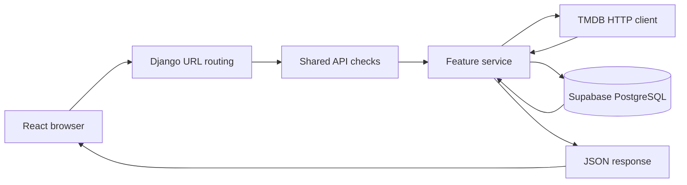

# CineScope backend: a guide you can read without knowing the whole project

Start here, dude. You do **not** need to memorize every file to work on this backend.
Pick one action, such as “show movie cards,” and follow that action through a few files.
This guide describes the code currently in this repository; it is not a new architecture plan.

## 1. What this backend actually does

There are three main places involved:

- **React UI:** displays screens and sends requests when you search, save, or sign in.
- **Django backend:** checks the request, applies our rules, and builds the response.
- **External data stores/services:** TMDB supplies entertainment metadata; Supabase
  PostgreSQL stores accounts and personal library data. Google supplies identity.

Think of Django as the coordinator. React says “find Animation AND Family titles.”
Django decides what is allowed, asks TMDB for candidates, checks them, and returns JSON.
React turns that JSON into cards. When you click Save, Django stores your relationship
to that title in PostgreSQL. It does not copy the entire TMDB catalogue into your database.

Posters may load from TMDB's image CDN and trailers play in YouTube embeds. React
must not call TMDB's JSON API with our secret credentials.



## 2. Read these files in this order

For a first pass, read only these:

1. [config/urls.py](../config/urls.py): the main route directory.
2. [common/urls.py](../common/urls.py): which product URL calls which function.
3. [common/api.py](../common/api.py): checks shared by product endpoints.
4. [catalog/services.py](../catalog/services.py): follow `discover()` first.
5. [catalog/normalization.py](../catalog/normalization.py): follow `summary()` and `genre_keys()`.
6. [catalog/client.py](../catalog/client.py): how the backend talks to TMDB.
7. [library/models.py](../library/models.py): what we store for a user's library.
8. [library/services.py](../library/services.py): follow `saved_title()`.

Stop after one walkthrough below and try it in Swagger. Leave guest synchronization,
OAuth internals, migrations, and cache locking for your second pass.

## 3. The names you will keep seeing

- **Endpoint:** a method and URL, such as `GET /api/v1/titles/`.
- **Request:** what the browser sends. It has a method, URL, headers, cookies and
  sometimes a JSON body.
- **Response:** what Django sends back: an HTTP status and usually JSON.
- **URL/path parameter:** part of the address, such as `movie` and `550` in
  `/api/v1/titles/movie/550/`.
- **Query parameter:** an option after `?`, such as `page_size=12`.
- **JSON body:** submitted data, such as `{"watched": true}` in a PUT request.
- **View:** Django/DRF's entry point for a matched request.
- **Serializer:** checks or describes the shape of data passing through the API.
- **Service:** an ordinary Python function that performs an application action.
- **Model:** a Python description of a database table and its relationships.
- **ORM:** Django's way of reading/writing SQL data through Python objects.
- **Migration:** a recorded database-structure change, run deliberately with `migrate`.
- **Cache:** a temporary remembered result so we can avoid doing the same work again.
- **Normalization:** translating different upstream formats into one CineScope format.
- **Authentication:** determining who is making the request.
- **Authorization/permission:** determining what that person is allowed to access.
- **Session:** server-side login state identified by a browser cookie.
- **CSRF:** protection against another website making unwanted actions using your cookies.
- **Transaction:** a group of database writes that either all succeed or all roll back.
- **Idempotent:** repeating the same operation does not create extra copies or effects.

An HTTP 200 means a successful response, but check its content type too. Your UI's
HTML page can also return 200; that does not make it an API JSON response.

## 4. Why you do not see one conventional view class per feature

This project deliberately shares its product request machinery.

In [common/urls.py](../common/urls.py), a route looks like:

```python
route("titles/", "titles/", get=catalog.discover)
```

Read this as: “For GET `/api/v1/titles/`, run the shared checks, then call
`catalog.services.discover`.” `catalog` here is an imported module alias, not a database.

`route()` passes the contract path and method/function mapping to `endpoint()` in
[common/api.py](../common/api.py). `endpoint()` creates a small `ContractView`
subclass using Python's `type(...)`. DRF then uses that class for the request.
You do not need to write a new class yourself for every product URL.

Inside `ContractView`, the line:

```python
get = post = put = patch = delete = execute
```

means those HTTP method names all enter the same `execute()` function. The
`handlers` dictionary chooses the actual feature function after the shared checks.
Each handler receives three arguments:

```python
handler(request, params, data)
```

- `request`: browser/session/user context.
- `params`: validated path and query values, already converted to appropriate types.
- `data`: validated JSON body, or an empty dictionary for a bodyless endpoint.

The original `core` endpoints use ordinary explicit APIView classes. That is why
you see `get()` methods in `core/views.py` but service functions for newer features.
Both approaches still use Django REST Framework.

## 5. Walkthrough: opening Discover

Example request:

```text
GET /api/v1/titles/?media_type=movie&genres=animation,family&year_from=2025&year_to=2025
```

Follow it in this order:

1. **`config/urls.py`** sees `/api/v1/` and checks the included route sets. Core
   does not own `titles/`, so the product route in `common/urls.py` matches.
2. **DRF/session authentication** identifies the browser user if a session exists.
   Discovery also allows guests.
3. **`ContractView.execute()`** starts the TMDB request allowance and selects GET's
   handler. It validates the inputs, applies the operation's login rule if any,
   and checks request throttling before calling `discover()`.
4. **`common/contract.py → inputs()`** finds this operation in `docs/openapi.yaml`.
   It converts `year_from` to an integer and `genres` to a list. Unknown names and
   invalid types are errors rather than silently ignored options.
5. **`catalog/services.py → discover()`** chooses locale/region, checks filter
   combinations, and asks `snapshot_page()` to provide the result page.
6. **`common/pagination.py`** either finds a valid frozen selection or calls the
   supplied factory function to build a new one. That function calls `candidates()`.
7. **`candidates()`** maps canonical genre keys to movie-specific TMDB numbers,
   requests a bounded candidate window through `TMDBClient`, normalizes cards,
   checks all active filters, and sorts within that window.
8. **`catalog/normalization.py → summary()`** converts TMDB fields into CineScope
   fields. For example, a TV `name` and a movie `title` both become `title`.
9. **`matches()`** requires both Animation AND Family and the selected year bounds.
10. **`snapshot_page()`** returns `count`, `results`, `next`, `previous`, and `meta`.
    DRF formats that Python dictionary as JSON for React.

You do not have to trace the full TMDB client every time. Once you know its
responsibility, treat `TMDBClient.get()` as “retrieve this external resource safely.”

### Two different genre number systems

A genre key such as `family` is our stable name. TMDB uses numbers, and movie/TV
taxonomies differ. `GENRES` in `catalog/normalization.py` is the translation map.
TV's combined Action & Adventure category expands to our `action` and `adventure`
keys; it does not magically give TMDB a more precise subgenre distinction.

User-selected genres are AND conditions. Recommendation seed genres sometimes
use OR to find candidates, but that never relaxes the user's explicit filters.

### Why a result count is not the size of the entire catalogue

The backend is designed for Vercel's request-based execution. It does not fetch
hundreds of detail pages for each screen.

- Ordinary catalogue discovery considers up to 40 source candidates.
- All media normally takes up to 20 movie and 20 TV candidates.
- Runtime filtering uses a deterministic six-title source window before runtime
  details are loaded; a narrower window can have fewer matches.
- Sorting and `count` describe the matching frozen selection, not every TMDB title.

An empty selection can therefore be valid even when another matching title exists
outside the candidate window. See the contract before changing these limits.

## 6. How TMDB caching and pagination work

There are **three different things called snapshots/cache**. Keep them separate:

1. **Upstream response cache:** `catalog/client.py` remembers TMDB JSON temporarily.
   PostgreSQL-backed Django `cache` supplies shared storage in production.
2. **Query snapshot:** `common/pagination.py` remembers one ordered result selection
   for five minutes. Its UUID is returned in `meta.snapshot`. Page 2 reads this same
   selection rather than making new TMDB calls and changing the order under the UI.
3. **`TitleSnapshot` model:** longer-lived minimal metadata for a title referenced
   by a save or recent-history row. This lets your library stay understandable even
   when TMDB is temporarily unavailable. It is not the query-pagination snapshot.

`factory()` in pagination is just “the function that knows how to build this list.”
It is called for a new snapshot, not every continuation page. The snapshot signature
binds filters, locale and page size; the scope binds private results to an owner or
share capability. A guessed snapshot UUID does not bypass login or sharing checks.

`TMDBClient.get()` works roughly like this:

1. Build a cache key from the TMDB path and parameters.
2. Return a valid cached result if present.
3. Check whether TMDB has recently asked us to slow down.
4. Attach backend-only bearer credentials, or the API-key fallback.
5. Acquire a short shared refresh lease and check the cache again.
6. Make the HTTP request within the remaining attempt/time budget.
7. Convert upstream errors into safe API errors, or cache successful JSON.

The lease prevents several serverless instances from refreshing the same key at
once. It is different from a transaction lock around an account change.
Network work is currently sequential, below the three-concurrent-call ceiling.
The client checks an eight-attempt/fifteen-second allowance around network calls;
it also has connection/read timeouts and only a limited safe-GET retry. This is not
a guarantee that all database or request-processing work always finishes in fifteen seconds.

Private list first pages are rebuilt; public catalogue query snapshots can be reused.
HTTP 410 means “this selection expired; restart from page 1,” not “the movie was deleted.”

## 7. Walkthrough: opening a movie and trailer

```text
GET /api/v1/titles/movie/550/?region=IN
```

`catalog.services.details()` asks for the title's core data plus credits/videos,
then separately obtains region-specific provider availability. It builds:

- A normalized `title` card, synopsis/tagline, and movie/TV-specific fields.
- Cast, directors, and TV creators.
- An ordered `trailers` array and a `selected_trailer_id`.
- Regional provider lists and a TMDB availability link.
- Warnings when an optional section could not be loaded.

`trailers()` accepts supported YouTube video types and valid video keys; it creates
embed/watch URLs rather than downloading videos. No trailer is represented by an
empty list and null selected ID. “No provider known for this region” differs from
“provider lookup temporarily failed.”

Core title failure cannot be disguised as a successful empty title. Optional
trailer/provider problems can still return a useful 200 detail response with warnings.
Refreshing details can update metadata for an already-referenced title; it does not
save a title into a user's library. Recently explored is recorded by a separate PUT,
so merely prefetching a detail response does not write browsing history.

## 8. Walkthrough: saving and marking a title watched

```text
PUT /api/v1/me/library/movie/550/
Body: {"watched": true}
```

1. Shared checks require a valid session, verified account and CSRF protection.
2. `library.services.saved_title()` resolves the title identity. A first-time
   reference may require TMDB validation before the write transaction starts.
3. `transaction.atomic()` starts an all-or-nothing group of database changes.
4. `lock_user()` obtains a database row lock for this owner. Another request changing
   the same owner's library must wait, helping make quota checks race-safe.
5. `persist_title()` ensures a referenced `TitleSnapshot` exists.
6. `ensure_saved()` reuses or creates that owner's `SavedTitle` row.
7. The function updates `watched` and its timestamp, then builds `saved_data()` JSON.

There is one saved row for this owner/title, not one watched copy and another
unwatched copy. Repeated `watched=true` preserves its existing watch time. Explicit
`watched=false` clears that time. Watched titles remain in the library.

DELETE explicitly unsaves the title and removes its custom collection memberships.
Removing only a collection membership does **not** unsave the title.

### Read ORM expressions as sentences

```python
SavedTitle.objects.filter(user=request.user).select_related("title")
```

Read it as: “Find saved rows owned by the logged-in user and load their linked
title data with them.” It describes a database query; creating a QuerySet alone
does not always execute SQL until it is evaluated.

- `.first()` returns the first match or `None`.
- `.exists()` asks whether a match exists.
- `.get()` expects exactly one row and raises if that expectation fails.
- `.get_or_create()` reuses a match or inserts one.
- `.update_or_create()` updates a match or inserts one.
- `.select_related()` avoids an extra database query per linked foreign-key row.
- `.bulk_create()` inserts several rows as a batch.
- `.select_for_update()` locks selected rows until the transaction ends; PostgreSQL
  concurrency behavior is stronger than what our SQLite unit tests can demonstrate.

## 9. What the models mean

Start with [library/models.py](../library/models.py). A model field describes stored
data. The small `class Meta` inside a model defines database rules/indexes, not a new table.

- **Django User:** existing built-in account, password hash and staff flags.
- **UserPreferences:** one display-name/language/region profile per user.
- **AccountToken:** one-time email verification/reset token hash and lifecycle.
- **allauth EmailAddress/SocialAccount:** verified email and Google identity linkage;
  we do not implement a duplicate ExternalIdentity table.
- **TitleSnapshot:** one referenced `(media_type, tmdb_id)` with normalized metadata.
- **SavedTitle:** owner + referenced title + watched state/timestamps.
- **Collection:** one owner-created custom collection.
- **CollectionMembership:** connects a collection to a saved title.
- **PublicShare:** sharing state, token hash and encrypted recoverable capability.
- **RecentTitle:** latest deliberate exploration time for an owner/title pair.
- **GuestCollectionMapping:** stable link from a browser's guest collection to its
  imported account collection; retained even when the collection is deleted.
- **SyncReceipt:** import request fingerprint/result for replay-safe retries.
- **CacheLease:** short coordination lock for TMDB refresh work.
- **RateLimitBucket:** a short-lived request counter. PostgreSQL locks the row while
  it changes, so two Vercel instances cannot overwrite each other's increments.
- **SampleRecord:** original database smoke-test row, independent of product titles.

`ForeignKey` means “many rows may point to this parent.” `OneToOneField` means only
one such row per parent. `unique`/`UniqueConstraint` prevents duplicates even when
two requests arrive together. An index accelerates a common lookup; it does not
itself authorize access. Ownership checks still belong in the service.

Deletion rules matter:

- `CASCADE`: deleting a parent removes dependent rows.
- `PROTECT`: do not delete a parent while referenced records depend on it.
- `SET_NULL`: keep the dependent record but clear its link. Guest-import tombstones
  use this so an old retry cannot quietly recreate something you intentionally deleted.

## 10. Collections and sharing in simple terms

Custom collections are real database records. A saved title can belong to several.
Automatic collections are calculated views of saved metadata: genres, decade,
TMDB rating 8+, Movies, TV Series and Watched. `automatic()` creates Python groups,
not `Collection` rows. IDs such as `auto:movies` are therefore read-only labels.

Public sharing has two addresses with different jobs:

```text
https://your-react-origin/shared/<token>       human opens this page
GET /api/v1/shared/<token>/                    React retrieves JSON here
```

`sharing()` generates a strong random token. The database stores a hash for lookup
and encrypted ciphertext so the owner can recover the same active URL later.
Hashing alone cannot recover a URL. Encryption can, but needs the separate
`SHARE_TOKEN_ENCRYPTION_KEY` kept securely in environment configuration.

`shared()` checks that the token is active **before** reading a cached page. Revoking
sharing therefore invalidates the capability, including old snapshot continuations.
Public JSON omits owner email and private saved/watched state. Title details and
trailers are independently public; revoking a collection is not a way to hide an
otherwise public movie's trailer.

## 11. Email login, cookies and CSRF

Three different secrets have different jobs:

- Your **password** proves account access and is stored as a Django password hash.
- The **session cookie** identifies the server-side login session. It is HttpOnly;
  React should send it with requests, not read it into localStorage.
- The **CSRF token** is supplied with unsafe requests alongside its cookie to help
  Django distinguish intended browser actions from another site's unwanted actions.

Usual email flow:

1. GET `/api/v1/auth/csrf/`: receive a masked token in JSON and the matching cookie.
2. POST register with `X-CSRFToken`: create a pending account and send verification.
3. React's email-link page POSTs the verification token to the API.
4. POST login: Django creates/rotates the session and CSRF token.
5. React stores the returned masked CSRF token in its request helper, sends cookies
   with `credentials: 'include'`, and fetches `/me/`.

`accounts/services.py` implements those actions. `AccountToken` stores hashes of
verification/reset tokens, never their raw emailed values. A token expires and can
be consumed once. Password reset changes the password hash, which invalidates old
sessions through Django's session-authentication checks.

Console emails are local-development conveniences. They print links in your own
terminal. Configuring that backend does not mean real users receive email.
Production delivery requires a real configured backend and separate end-to-end testing.

## 12. Google OAuth without the confusing parts

Read [accounts/oauth.py](../accounts/oauth.py) after understanding email sessions.

Our POST `/api/v1/auth/oauth/start/` is the frontend-facing start action. It asks
django-allauth to prepare Google's authorization URL, state and PKCE information.
React navigates to Google. Google returns to exactly:

```text
http://localhost:8000/accounts/google/login/callback/
```

for configured local development. The callback uses **allauth's callback lifecycle**,
not a second competing versioned callback. Our adapter specifies the configured
public URL and enforces CineScope's email/redirect policies.

- **State:** ties the return to the browser that started login and prevents replay.
- **PKCE:** ties the authorization-code exchange to the original login attempt.
- **Adapter:** a library-provided extension point where we customize policy without
  reimplementing its full OAuth protocol.

Google verification must not silently attach a new identity to an existing local
account just because its email matches. The code requires existing-account login
instead of guessing that linking is safe.

Use localhost consistently, not localhost for one step and 127.0.0.1 for another.
Google's authorized redirect URI must match the actual public callback exactly.
Mocked tests prove our integration logic, not real Google consent/production setup.

## 13. Guest sync: why this file is more involved

[library/sync.py](../library/sync.py) handles a difficult action: copying browser
guest data into an account without duplicates or accidental loss.

Imagine you save a title as a guest, then sign in and click Sync. The browser might
retry because a response was lost. Without protection that could create duplicate
collections or overwrite account choices.

Follow these stages:

1. `validate_payload()` checks duplicate references, collection IDs, limits and times.
2. Hash the payload and look for an existing `SyncReceipt` for its `sync_id`.
3. If already completed with the same payload, return the original result.
4. Resolve unknown title identities before beginning account writes. A transient
   TMDB failure must not leave half the library imported.
5. Begin a transaction, lock the owner and check the receipt again after waiting.
6. Batch-create missing referenced metadata and saved rows.
7. Merge watched status with OR: existing true is not overwritten by guest false.
8. Reuse stable guest collection mappings, preserve account names and union members.
9. Give a new name collision an `Imported 2` suffix rather than overwriting a collection.
10. Reject a source mapping whose collection was intentionally deleted.
11. Save the response receipt in the **same transaction** as the merge.

`sync_id` identifies one immutable attempt; `guest_id` identifies a browser guest
namespace; `client_id` identifies one guest collection. They are not interchangeable.
Retry the same attempt with the same `sync_id` and payload. Changing the payload
with that same ID returns 409. This replay guarantee lasts 24 hours; durable database
uniqueness/mapping rules still prevent duplicate rows afterward.

Choosing Not Now in React must make no sync request. Django does not silently sync
on login. React clears only accepted items from the exact submitted local snapshot;
it must preserve newer local edits and rejected items.

## 14. File map: where to look for a change

### Startup and configuration

- `manage.py`: terminal commands, including runserver, migrate, test commands and admin setup.
- `config/settings.py`: settings sections are annotated in the source. Environment
  loading happens before integrations are configured. Debug, hosts, middleware,
  database, REST settings, CORS/CSRF, auth, email, TMDB/cache and logging live here.
- `config/urls.py`: top-level routing; admin and documentation are outside product routes.
- `config/wsgi.py`, `config/asgi.py`: hosting entry points; do not put feature logic here.
- `vercel.json`: Django deployment/function settings; it is not the frontend proxy config.
- `.vercelignore`, `.gitignore`: exclude local environments, tools, caches and secrets.
- `.python-version`: selects the deployment Python family.
- `.env.example`: safe configuration names/examples, never actual secrets.
- `.env`, `.env.vercel.local`: ignored real settings. Changing a local file does not
  update Vercel's environment automatically.
- `pyproject.toml`: runtime dependencies and tool settings. `uv.lock` freezes versions;
  `requirements.txt` and `requirements-dev.txt` provide pip equivalents. Do not hand-edit
  generated lock files as your first approach to dependency changes.

### Shared request machinery

- `common/urls.py`: add/find a product route and its feature handler here.
- `common/api.py`: request security, limits and dispatch.
- `common/throttling.py`: shared request/email counters and trusted client-IP handling.
- `common/authentication.py`: Django session authentication's API 401 behavior.
- `common/contract.py`: strict contract-based input serializer/validation.
- `common/errors.py`: safe exception-to-JSON translation.
- `common/middleware.py`: request IDs, private cache headers and CSRF error JSON.
- `common/logging.py`: hides capability/OAuth query secrets in console messages.
- `common/pagination.py`: immutable result selections and page links.
- `common/schema.py`: serves the reviewed OpenAPI schema through drf-spectacular.

### Account, catalogue, library and scaffold files

- `accounts/models.py`: preference and account-token fields.
- `accounts/services.py`: email/password/profile workflows.
- `accounts/oauth.py`: Google/allauth policies, initiation and callback adapter.
- `accounts/admin.py`: preference management screen.
- `catalog/models.py`: referenced metadata, shared refresh leases and rate-limit buckets.
- `catalog/normalization.py`: card/person/video translation, genre/mood mappings.
- `catalog/client.py`: TMDB HTTP/cache/error handling.
- `catalog/leases.py`: short shared refresh coordination.
- `catalog/services.py`: discovery, people, metadata and details workflows.
- `catalog/recommendations.py`: surprise/mood/personalized selection and scoring.
- `catalog/admin.py`: metadata inspection in Django admin.
- `library/models.py`: saved rows, custom collections, sharing, recents and sync state.
- `library/services.py`: normal library/collection/sharing/history actions.
- `library/sync.py`: explicit atomic guest import and replay receipts.
- `library/admin.py`: library-related staff screens and ownership safeguards.
- `core/apps.py`: registers the original core app.
- `core/models.py`, `core/serializers.py`, `core/views.py`, `core/urls.py`: small original
  sample/health feature, with conventional explicit DRF classes.
- `core/admin.py`: sample model registration and admin branding.

### Database history and maintenance

- `core/migrations/0001_initial.py`: original sample table.
- `accounts/migrations/0001_initial.py`: preferences and email tokens.
- `accounts/migrations/0002_email_uniqueness.py`: audits existing emails, then adds
  case-insensitive uniqueness without deleting duplicates to force a migration through.
- `catalog/migrations/0001_initial.py`: referenced-title and lease tables.
- `catalog/migrations/0002_shared_cache.py`: creates Django's database-cache table.
- `library/migrations/0001_initial.py`: library/collection/share/recent/sync tables and rules.
- `core/management/commands/seed_sample.py`: explicitly create the demonstration row.
- `catalog/management/commands/cleanup_expired.py`: explicitly prune expired records
  and unreferenced metadata. This command deletes data; it is not a read-only demo.
- `__init__.py` files: mark Python packages/migration folders; intentionally little
  or no executable work belongs in them.

Models describe the desired structure; migrations describe the history used to get
there. Editing a model does not update PostgreSQL until a new migration is created
and applied. Do not rewrite already-applied history to “make it look cleaner.”

### Tests and specifications

- `tests/settings.py`: disposable SQLite and local cache/email settings, not Supabase.
- `tests/conftest.py`: shared fake data/users/cache, no-live-network protection and
  successful-response checks against the OpenAPI schemas.
- `tests/test_accounts.py`: email, CSRF, preferences and mocked OAuth.
- `tests/test_catalog.py`: filters, normalized cards, moods, trailers, caching and routes.
- `tests/test_library.py`: saves, watched state, collections, shares and guest sync.
- `tests/test_edge_cases.py`: limits, malformed inputs, secrecy, retry and expiry cases.
- `tests/test_health.py`, `test_samples.py`, `test_admin.py`: original infrastructure tests.
- `tests/test_vercel_settings.py`: isolated process checks for production debug/hosts.
- `docs/API_CONTRACT.md`: precise behavior and architecture decisions.
- `docs/openapi.yaml`: machine-readable fields/paths, also used by input validation
  and Swagger. It is not merely a static document detached from runtime behavior.
- `README.md`: installation, environment, commands and deployment instructions.

## 15. A short Python-reading cheat sheet

```python
{"media_type": "movie", "tmdb_id": 550}  # dictionary: named pieces of data
["animation", "family"]  # list: ordered items
("movie", 550)  # tuple: paired identity
```

`data["watched"]` requires the key. `data.get("limit", 10)` supplies 10 if omitted.
`None` means no known value; it becomes JSON null. A missing runtime is not zero.

```python
[saved_data(row) for row in rows]
```

Read this list comprehension as “for each row, convert it using saved_data and
collect the results.” A dictionary comprehension `{key(row): row for row in rows}`
builds a lookup so we can find an item by identity without repeatedly scanning a list.
A set `{...}` removes duplicates; sets are useful for overlap/AND/union checks.

`**values` expands dictionary entries as named function arguments or merges fields
into a new dictionary. `*args`/`**kwargs` accept additional arguments; route values
arrive through kwargs before our input checker processes them.

`lambda: candidates(...)` is a small unnamed function: it delays building the list
until pagination actually needs it. `@transaction.atomic` wraps the function in a
transaction. `@lru_cache` remembers a function's result within this Python process;
here it remembers schema definitions, not shared production catalogue results.

`with ...:` ensures setup/cleanup around a block, even on an exception. `raise APIError`
exits normal execution; the shared error handler produces the HTTP response.
`return Response(status=204)` intentionally returns no JSON body.

### Reading a test without being confused by the setup

A test usually has three parts: prepare fake data, perform an action, then check
the result. `assert response.status_code == 200` means “fail this test if that
condition is false.” It does not change application behavior.

An argument such as `api`, `user` or `title` in a test function is usually a pytest
**fixture**, not a value passed by the real browser. Look for its `@pytest.fixture`
definition in `tests/conftest.py`. For example, the `api` fixture signs a fake user
into a test client. A test client calls Django without opening a real browser.

`with patch("catalog.services.TMDBClient.get", return_value=...)` temporarily replaces
that function for this test. We can check our filtering without depending on live
TMDB or consuming its quota. The replacement ends when the with-block finishes.
Mocked Google callbacks similarly test our integration logic without proving real
Google consent works. The automatic response-check fixture also validates successful
test-client responses against the contract.

`@pytest.mark.django_db` or a fixture depending on `db` permits access to the disposable
test database. Unmarked tests are prevented from accidentally using the database.
This distinction is why a simple pure-Python normalization test needs less setup
than a library-saving test.

## 16. Debug the right layer

When something fails, ask these questions in order:

1. **Did React make the intended request?** Check Network → URL and method.
2. **Did it get JSON?** HTML for `/api/v1/...` often means the frontend SPA fallback
   handled the request instead of proxying to Django.
3. **What status and safe error code came back?** Read the Response tab, not just the UI message.
4. **Which route/service owns that operation?** Find it in `common/urls.py`.
5. **Which stage can fail?** Input, login/CSRF, ownership, database, external provider or snapshot expiry.
6. **Does the same request work directly on the backend?** If yes but the UI-origin
   URL returns HTML, fix proxy/deployment routing rather than TMDB code.

Common interpretations:

- 400: invalid or undocumented input; inspect `error.fields`.
- 401: no valid authenticated session; an expired session is possible.
- 403: permissions, unverified email or CSRF; look at the error code and cookie flow.
- 404: missing resource, another owner's private object, or invalid/revoked share.
- 409: duplicate name, quota, changed sync payload or a deleted import source.
- 410: restart expired result pagination.
- 429: our request throttle; wait before retrying.
- 502: malformed/rejected upstream data.
- 503: dependency unavailable, refresh contention/backoff or missing integration configuration.
- 504: external time/attempt budget exhausted.

Use `X-Request-ID` to connect a failed response to safe logs. Do not log passwords,
bearer tokens, raw share tokens, OAuth codes or full private payloads while debugging.
`/health/` only proves the process responds; `/health/db/` checks PostgreSQL, not TMDB,
Google consent, email delivery or frontend routing.

## 17. Local and deployed environments are separate

Frontend `VITE_*` values are compiled into public browser code. Backend secrets
must not go there. Runtime Django configuration comes from local `.env` or Vercel's
backend project environment, depending on where it runs.

The frontend's production API base is `/api/v1/` with `VITE_API_MODE=live`. Vercel
frontend rewrites must proxy both `/api/*` and `/accounts/*` to Django before React's
fallback. Those rules live in the frontend repository, not this backend `vercel.json`.

`BACKEND_PUBLIC_ORIGIN` means “the API/OAuth origin the browser sees.” With a
same-origin proxy it can be the React origin even though Django executes in a separate
Vercel project. `FRONTEND_PUBLIC_ORIGIN` means “where human-facing React pages live.”
See README for exact domains and rewrites; unrelated vercel.app domains are not a
reliable direct cross-site session-cookie strategy.

Changing `.env` needs a local restart. Changing Vercel variables needs redeployment.
Changing Vite variables needs a new frontend build. A local credential file is not
uploaded into Vercel's environment just because you pushed source code.

## 18. A practical way to learn this in small sessions

**Session 1 — read-only discovery:** start Django, open Swagger, call health,
metadata and titles, then follow walkthrough 5. Add a genre filter and observe
the request/response. Read one existing filter test beside the matching function.

**Session 2 — persistence:** use an isolated learning database if you want to edit
data. Read the SavedTitle model, follow walkthrough 8 and inspect a saved row in
admin. Remember your usual local environment currently points at online Supabase;
local execution does not automatically mean disposable data.

**Session 3 — account/security:** follow email login locally and watch the cookie
and X-CSRFToken flow. Read `tests/test_accounts.py` before diving into OAuth internals.

**Session 4 — collections and sync:** compare a normal custom collection with an
automatic group. Then trace a guest sync test: first request, identical retry,
changed-payload conflict and deletion tombstone.

For every function, write four answers in your own words: **what enters, what it
checks, what it reads/writes, and what it returns**. If those are clear, you already
understand its role even if some Python syntax is new.

Useful commands from the backend repository root:

```powershell
$env:DEBUG = 'True'
.\.venv\Scripts\python.exe manage.py runserver localhost:8000
```

In another terminal, these checks do not apply database migrations:

```powershell
.\.venv\Scripts\python.exe manage.py check
.\.venv\Scripts\python.exe -m pytest tests/test_catalog.py -o cache_dir=.tools/pytest-cache
.\.venv\Scripts\python.exe -m pytest tests/test_library.py -o cache_dir=.tools/pytest-cache
.\.venv\Scripts\python.exe -m ruff check .
```

The test settings use their own disposable database and block unmocked HTTP. They
are the safest place to experiment with behavior. They do not prove real Google
consent, production SMTP, frontend proxy behavior or concurrent PostgreSQL locking.

## 19. Where to make a future change

- New discovery input: contract/YAML → validation rules → TMDB pushdown/post-filter
  logic → focused tests → frontend type/client update.
- Different normalized response field: contract/schema → normalization/response
  builder → response tests → frontend consumer.
- New stored information: model → new migration → service logic → isolated database tests.
- New mood rules: mappings + version + contract examples + recommendation tests.
- Login/cookie issue: browser request/cookies/origins → shared checks → account
  service/allauth adapter → deployment configuration, depending on the failing stage.
- Wrong public link host: `FRONTEND_PUBLIC_ORIGIN` and `share_url()`, not TMDB credentials.
- Wrong next-page host: `BACKEND_PUBLIC_ORIGIN` and pagination, not collection models.

Comments explain the intent of blocks and functions. They are meant to help you
follow the actual code, not replace it. If behavior is changed later, update its
comment, contract and test together so this guide remains trustworthy.
